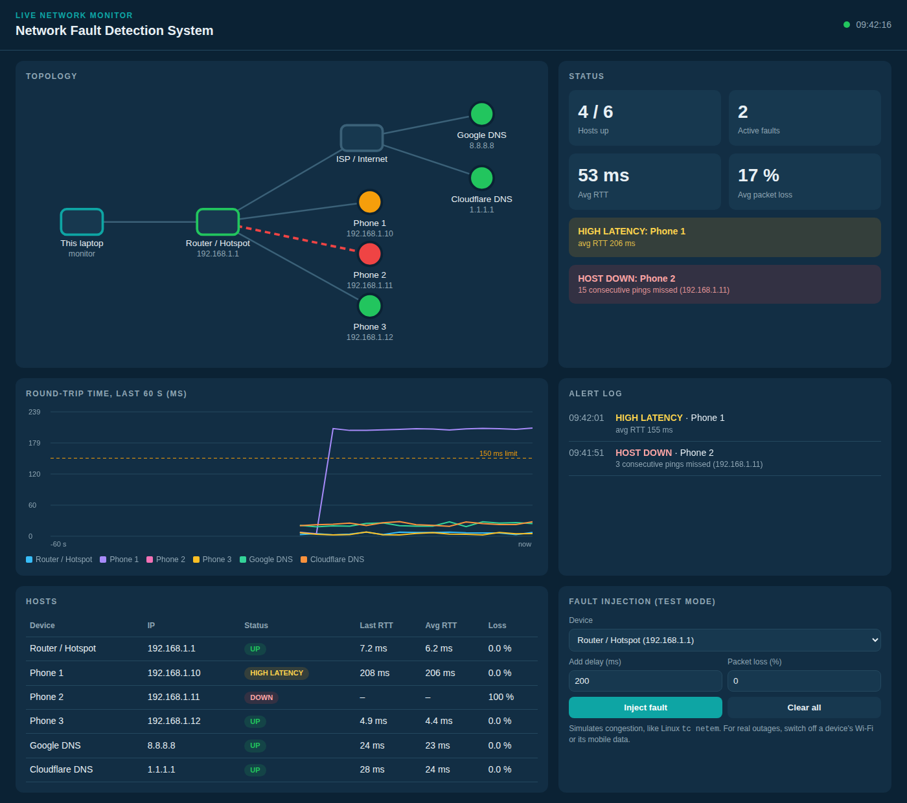

# Network Fault Detection System

A software-only prototype that continuously monitors devices on a network, detects faults, works out **where** they are, and shows everything on a live web dashboard.



## What it detects

| Fault | Rule |
|---|---|
| **HOST DOWN** | 3 consecutive missed pings (≈6 s) |
| **DEGRADED** | > 20% packet loss over the last 10 probes |
| **HIGH LATENCY** | average RTT > 150 ms over the last 10 probes |
| **INTERNET LINK DOWN** | router reachable but *all* internet hosts down → Router ↔ ISP link failed |
| **LOCAL LINK DOWN** | router unreachable → laptop ↔ router (Wi-Fi) link failed |
| **RECOVERED** | a fault clears |

## Setup

1. Install Python 3, then:
   ```
   pip install -r requirements.txt
   ```
2. Connect your laptop and 2–3 phones to the **same phone hotspot or home Wi-Fi**
   (college Wi-Fi usually blocks devices from pinging each other).
3. Find the IPs:
   - Laptop: run `ipconfig` (Windows). The **Default Gateway** is the router/hotspot IP.
   - Phones: Settings → Wi-Fi → tap the network → IP address.
4. Put those IPs in the `HOSTS` list at the top of `app.py`.
5. Run:
   ```
   python app.py
   ```
   and open **http://localhost:5000**.

## Demo

| Action | Expected result |
|---|---|
| Turn off a phone's Wi-Fi | 🔴 HOST DOWN in ~6 s |
| Turn off mobile data on the hotspot phone | 🔴 INTERNET LINK DOWN (phones stay green) |
| Turn off the laptop's Wi-Fi | 🔴 LOCAL LINK DOWN |
| Fault injection panel → 200 ms delay | 🟡 HIGH LATENCY |
| Fault injection panel → 30% loss | 🟡 DEGRADED |
| Turn everything back on | 🟢 RECOVERED |

Tip: keep phone screens on during the demo, because sleeping phones may stop answering pings.

## How it works

- `ping()` sends one ICMP echo request per host (works on Windows, macOS and Linux).
- All hosts are probed **in parallel** (threads) every 2 seconds.
- `classify()` applies the rules above to a sliding window of the last 10 probes.
- `find_faults()` correlates host states to localize link failures.
- Flask serves the dashboard (`/`), a JSON API (`/status`), and a test-mode fault injector (`/inject`).

## Project structure

```
app.py                 monitor + fault detection + Flask server
templates/index.html   live dashboard (topology, stats, RTT chart, alert log)
requirements.txt
```
